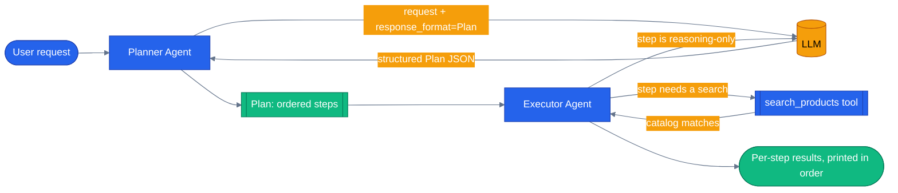

# Chapter 29 — Planner-Executor

This chapter splits a multi-step request between two agents. A planner turns the request into an ordered list of steps before anything runs, and an executor then carries out the steps one at a time.

**You will learn to:**

- Get a plan from a model as structured output (a Pydantic model) instead of free text
- Run each plan step through an executor agent that shares one session across steps
- Show the whole plan to a user or a log before the first tool call
- Choose between planning up front and deciding one tool call at a time

## Why this chapter

Most orchestration chapters in this series have the model decide **one tool call at a time**,
based on what it currently knows. So does the default `tool` mode of the capstone (the full
application in this repo). That is simple and adaptive. For a multi-step shopping request such as
"help me put together a birthday gift for someone who likes photography under $200", it also means
you never see the whole plan before the agent starts acting. You cannot approve it, estimate its
cost, or find where it went wrong until it is three tool calls deep.

Planner-executor reverses the order. The request is decomposed into an ordered list of concrete
steps **up front**, as structured output, and only then does each step run. You can inspect the
plan before a single tool fires.

This chapter builds a minimal pair for the e-commerce domain. A planner agent turns a shopping
request into a `Plan` of ordered `PlanStep`s. An executor agent runs each step. It calls an
in-memory `search_products` tool when a step needs catalog data, and reasons over earlier results
otherwise.

## Prerequisites

- Completed [Chapter 02 — Adding Tools](../02-add-tools/) (the `@tool` decorator shape reused here)
- Familiar with [Chapter 04 — Sessions](../04-sessions/) (`AgentSession`, which the executor shares across steps)
- No API key needed: with none set, `main.py` replays recorded responses and prints one line saying so. To use a live model instead, put `OPENAI_API_KEY` (or the `AZURE_OPENAI_*` variables) in the repo-root `.env`

## The concept

A planner-executor system is two agents (or two roles played by one model) with a hard boundary
between them:

1. **The planner** sees only the user's request. It never touches a tool. Its one job is to
   produce a `Plan`, an ordered list of `PlanStep`s, as **structured output**: a Pydantic model
   passed as `response_format`, not prose that other code would have to parse with a regex.
2. **The executor** never sees the original request, only one step at a time. For each step it
   either calls a tool (if the step names a catalog search) or reasons over what earlier steps
   produced, then returns a result. The plan never changes mid-run. No step result feeds back
   into deciding what step 3 should be.

The trade-off is deliberate: **predictable and inspectable, at the cost of adaptability.**
Reactive tool-calling (Chapter 02, and the application's `tool` mode) makes the opposite trade.
The model decides the next action every turn, so it reacts at once to a surprising tool result.
But there is no plan to show a user before execution starts, and no single place to log what the
run intends to do.

Use planner-executor when seeing the whole plan first has value: approval gates, cost estimates
before execution, step-by-step debugging. Use reactive tool-calling when the task is usually one
hop and a full plan would be ceremony.

This chapter does **not** build automatic re-planning. If step 2's search comes back empty, the
executor still runs steps 3 and 4 as written. A fuller planner-executor adds a loop that calls the
planner again when a step's result invalidates the rest of the plan.
[`docs/concepts/06-orchestration-patterns.md`](../../docs/concepts/06-orchestration-patterns.md)
calls that adaptive version **Magentic**. The application does not implement it (see Gotchas).



The plan is fully formed, and printable, before the executor runs its first step. Nothing about
step 2 depends on the planner reconsidering step 1.

## Python

Run from the repo root. The shared `tutorials/` uv project covers every chapter, so one `uv sync` is enough:

```bash
uv sync --project tutorials
uv run --project tutorials python tutorials/29-planner-executor/python/main.py
```

You should see the plan's goal first, then each step with its result:

```text
No LLM key found - replaying the recorded fixture (set OPENAI_API_KEY or the AZURE_OPENAI_* variables for a live run).
Request: Help me put together a birthday gift for someone who likes photography, under $200.

Plan: Select a photography-related birthday gift under $200.

1. Search for photography-related products.
   -> Here are the photography-related products found:

- Compact Mirrorless Camera ($189)
- 50mm Prime Lens ($129)
...

2. Filter the results to items priced under $200.
   -> The following photography-related products are priced under $200:
...

3. Pick the best-suited items for a birthday gift from the filtered results.
...

4. Summarize a top recommendation for a photography gift within the budget.
   -> Top Recommendation: The Compact Mirrorless Camera ($189) is the best photography gift within your $200 budget. ...
```

Source: [`python/main.py`](./python/main.py). The plan is a Pydantic model, not free text:

```python
class PlanStep(BaseModel):
    step: int = Field(description="1-based order of this step in the plan.")
    action: str = Field(description="Short human-readable description of what this step accomplishes.")
    query: str | None = Field(
        default=None,
        description="Catalog search text for this step, or null if the step only reasons over prior results.",
    )


class Plan(BaseModel):
    goal: str = Field(description="One-sentence restatement of what the user wants overall.")
    steps: list[PlanStep] = Field(description="Ordered steps that together satisfy the goal.")
```

The planner call asks for that shape through `response_format`, and `response.value` returns
an already-parsed `Plan`. There is no manual JSON parsing in this chapter's code:

```python
async def make_plan(planner: Agent, request: str) -> Plan:
    response = await planner.run(request, options={"response_format": Plan})
    plan = response.value
    if plan is None:
        raise ValueError(f"planner did not return a parseable plan; raw text: {response.text!r}")
    return plan
```

The executor runs one step at a time on a **shared session**, so step 2 ("filter by price") can
see step 1's search results without the caller restating them:

```python
async def run_plan(request: str) -> tuple[Plan, list[str]]:
    planner = build_planner_agent()
    executor = build_executor_agent()
    plan = await make_plan(planner, request)
    session = executor.create_session()
    results = [await run_step(executor, session, step) for step in plan.steps]
    return plan, results
```

## .NET

Source: [`dotnet/Program.cs`](./dotnet/Program.cs).

```bash
# From the repo root. Needs no API key.
dotnet test tutorials/29-planner-executor/dotnet/tests/PlannerExecutor.Tests.csproj

# Needs an API key in the repo-root .env. Note the cd.
cd tutorials/29-planner-executor/dotnet
dotnet run
```

`dotnet run` calls a live model, so it needs `OPENAI_API_KEY` or the `AZURE_OPENAI_*` variables. Run the tests first if you have no key.

Structured output uses the generic `RunAsync<T>` overload where Python uses `response_format=`:

```csharp
var response = await planner.RunAsync<Plan>(request, serializerOptions: AIJsonUtilities.DefaultOptions);
```

`AgentResponse<T>.Result` deserializes lazily and throws on bad JSON. `MakePlanAsync` catches that and rethrows with the raw text quoted. "The model ignored the schema" then arrives as one actionable message, not a `JsonException` from inside the framework. Executing a half-parsed plan is worse than not executing one.

The session is `AgentSession`, created once and reused across every step:

```csharp
AgentSession session = await executor.CreateSessionAsync();
foreach (PlanStep step in plan.Steps)
{
    results.Add(await RunStepAsync(executor, session, step));
}
```

Two properties carry the pattern, and neither is visible from the API:

- **The planner has no tools.** `The_Planner_Is_Given_No_Tools` asserts it. Give it any and it will search instead of planning, and you get a reactive agent that also emits a plan it has already stopped following.
- **Every step shares one session.** Without this there is no error: step 3 sees an empty conversation, has nothing to pick from, and invents a plausible recommendation. `All_Steps_Share_One_Session_So_Later_Steps_See_Earlier_Results` asserts the conversation grows, which is the only way to catch it.

## Gotchas

- **`Agent(client, response_format=Plan, ...)` does not work.** `response_format` goes on `run()`,
  per call: `agent.run(request, options={"response_format": Plan})`. `response.value` does the
  JSON parsing, and `response.text` still gives you the raw model output if parsing fails.
- **The executor runs zero steps and nothing fails.** A missing or malformed structured response
  shows up as `response.value is None`, not as an exception. `make_plan()` raises explicitly with
  the raw text attached, so a bad plan fails loudly.
- **A later step invents results it never saw.** That happens when each step gets a fresh executor
  or a fresh session, which loses step 1's search results before step 2 runs. The executor's
  `AgentSession` is shared across all steps on purpose. `InMemoryHistoryProvider()` on
  `build_executor_agent()` is what makes "filter the results from step 1" resolvable.
- **The executor carries on after a step comes back empty.** There is no re-planning. If a search
  step returns zero matches, the remaining steps still run as written. The adaptive version of the
  pattern is Magentic, which the application does not implement: `get_mode()` raises an
  `UnknownModeError` that names `magentic` as not implemented
  (`agents/python/orchestrator/modes/__init__.py`).
- **One run produces several fixture files.** A 4-step plan needs one planner fixture plus at
  least one executor fixture per step. `ReplayChatClient` keys each fixture on the exact request
  (messages, tools and instructions), so the planner and executor never collide in the shared
  `FIXTURES_DIR`.

## Tests

```bash
uv run --project tutorials pytest tutorials/29-planner-executor/python/tests -v
dotnet test tutorials/29-planner-executor/dotnet/tests/PlannerExecutor.Tests.csproj
```

Run both from the repo root. Neither needs an API key.

The tests prove that the planner is built with no tools, that the executor holds `search_products`,
and that the tool filters by keyword and price. A replay test plans and executes the full request
against recorded model responses. Tests against a live model are skipped unless credentials are
present.

## How this shows up in the capstone

The application does not run planner-executor as an orchestration mode. Its default `tool` mode is
the reactive alternative described above, and the nearest thing to this chapter in it is the tool
the executor calls. `agents/python/product_discovery/tools.py` defines the application's
`search_products`, which answers a shopper's catalog questions in chat:

```python
@tool(
    name="search_products",
    description=(
        "Search the product catalog using natural language. Supports filtering by category, price range, and rating."
    ),
)
async def search_products(
```

It has the same `@tool` and `Annotated` shape as this chapter's version. The application's adds
`async`, Postgres full-text search through `get_pool()`, and more filter parameters. The model
still decides when to call it and with what arguments.

`agents/python/orchestrator/modes/__init__.py` is where `get_mode()` rejects an unknown mode
name and states that `magentic`, the re-planning form of this pattern, is not implemented. See
[`docs/concepts/06-orchestration-patterns.md`](../../docs/concepts/06-orchestration-patterns.md)
for a comparison of the modes the application does run.

## What's next

- Related: [Chapter 27 — Agent-as-Tool](../27-agent-as-tool/)
- Full source: [`python/`](./python/)
- Shared: [Mermaid style guide](../_shared/mermaid-style-guide.md) · [Orchestration patterns](../../docs/concepts/06-orchestration-patterns.md)

<!-- BEGIN GENERATED CHAPTER NAV -->
---

**Previous:** [Chapter 28 — Reflection and Critique](../28-reflection-and-critique/) · [Series index](../README.md) · **Next:** [Chapter 30 — Subworkflows](../30-subworkflows/)
<!-- END GENERATED CHAPTER NAV -->
