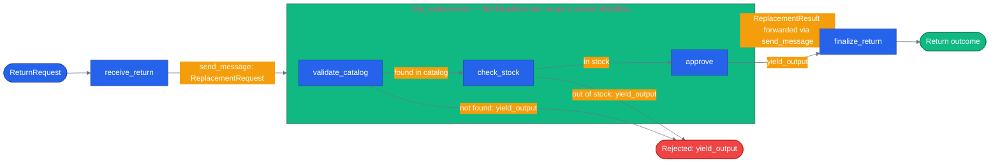

# Chapter 30 — Subworkflows

This chapter nests one MAF workflow inside another, so a multi-step pipeline becomes a single node of a larger graph and can be reused without copying its steps.

**You will learn to:**

- Wrap a `Workflow` in a `WorkflowExecutor` and use it as one node of an outer workflow
- Control where the inner workflow's output goes with `allow_direct_output`
- Build a fresh inner workflow per wrapper so two runs never share state
- Tell when a shared single step is enough and a subworkflow is more than you need

## Why this chapter

Chapters 09–13 built graphs out of executors (the nodes of a workflow) that each do one small thing: uppercase a string, check stock, merge three results. Real systems eventually need a *step* that is not small. "Find and validate a replacement product" is itself a little pipeline: look it up, check stock, decide.

Suppose two outer workflows both need that pipeline, for example a return-and-replace flow and a low-stock substitution flow. You could copy the three executors into each one, and then keep two copies in sync. Or you could flatten everything into one large graph that mixes two concerns and loses the outer flow as something you can inspect on its own.

Ordinary code solves this by extracting shared logic into a subroutine. In MAF the subroutine is itself a `Workflow`, and the framework ships a built-in way to nest one `Workflow` inside another as a single node.

## Prerequisites

- Completed [Chapter 09 — Workflow Executors and Edges](../09-workflow-executors-and-edges/)
- Python 3.12+ via `uv`
- No API key and no environment variables needed. This chapter runs deterministic executors over a small in-memory catalog and makes no LLM calls.

## The concept

`agent_framework` ships a `WorkflowExecutor` class, exported from the top-level package, built for this. Its docstring describes it as *"An executor that wraps a workflow to enable hierarchical workflow composition"* that *"makes a workflow behave as a single executor within a parent workflow."* You do not write a custom wrapper. You construct `WorkflowExecutor(inner_workflow, id="...")` and put it in an outer `WorkflowBuilder` where you would otherwise put a plain `Executor`.

The constructor is `WorkflowExecutor(workflow, id, allow_direct_output=False, propagate_request=False, **kwargs)`. It takes a `Workflow` instance, built the normal way with `WorkflowBuilder(...).build()`, and an `id` for the wrapper node. When a message arrives at that node, `WorkflowExecutor` runs the wrapped workflow until it completes or goes idle waiting on a pending request. Then it does two things with what the subworkflow produced:

- **Outputs** are anything the inner workflow's executors passed to `ctx.yield_output(...)`. By default they are forwarded to the parent workflow as a regular `ctx.send_message(...)`, so the next executor on the wrapper node's outbound edge receives them like any other message. With `allow_direct_output=True`, the subworkflow's output becomes the *outer* workflow's own final output and skips whatever comes after the wrapper node.
- **Requests** arise when an inner executor calls `ctx.request_info(...)`, for example a nested human-in-the-loop (HITL) approval gate. With `propagate_request=True` they go to the parent workflow's own `request_info` mechanism. Otherwise they are wrapped in a `SubWorkflowRequestMessage` and sent to whichever executor in the parent graph is wired to receive it.

This demo builds an inner workflow, `find-replacement`, with three executors: `validate_catalog` → `check_stock` → `approve`, and two early rejections. The outer workflow, `process-return`, is `receive_return` → the wrapped inner workflow → `finalize_return`. The outer graph never duplicates the catalog and stock logic. It points a `WorkflowExecutor` node at a freshly built inner `Workflow`.



The `sub` box is the whole nested `Workflow`: three executors and their own early exits, collapsed into one node (`find_replacement`) from the outer graph's point of view. The outer graph has two edges, `receive_return → find_replacement` and `find_replacement → finalize_return`. That is all `process-return` needs to know about the inner pipeline.

## Python

Run from the repo root. The shared `tutorials/` uv project covers every chapter, so one `uv sync` is enough:

```bash
uv sync --project tutorials
uv run --project tutorials python tutorials/30-subworkflows/python/main.py
```

You should see:

```text
--- Return R-1001: requested replacement 'sku-mug-red' ---
Return R-1001: replacement sku-mug-red approved and shipped (in stock: Ceramic Mug — Red).

--- Return R-1002: requested replacement 'sku-mug-blue' ---
Return R-1002: replacement sku-mug-blue rejected (out of stock) — issuing a refund instead.

--- Return R-1003: requested replacement 'sku-unknown' ---
Return R-1003: replacement sku-unknown rejected (not found in catalog) — issuing a refund instead.
```

Each scenario makes the full nested round trip. The outer workflow receives the request and hands it to the inner workflow. The inner workflow runs its own three-step graph to a `yield_output`. `WorkflowExecutor` forwards that as a message into the outer graph, and `finalize_return` turns it into the final text.

Source: [`python/main.py`](./python/main.py). Building the inner workflow uses the same `WorkflowBuilder` shape as Chapter 09:

```python
def build_find_replacement_workflow() -> Workflow:
    validate = _ValidateCatalogExecutor()
    stock = _CheckStockExecutor()
    approve = _ApproveExecutor()
    return (
        WorkflowBuilder(start_executor=validate, name="find-replacement")
        .add_edge(validate, stock)
        .add_edge(stock, approve)
        .build()
    )
```

Nesting it inside the outer workflow is the one new piece. `WorkflowExecutor` goes into `add_edge(...)` like any other `Executor`:

```python
def build_process_return_workflow() -> Workflow:
    receive = _ReceiveReturnExecutor()
    find_replacement = WorkflowExecutor(
        build_find_replacement_workflow(),
        id="find_replacement",
        allow_direct_output=False,
    )
    finalize = _FinalizeReturnExecutor()
    return (
        WorkflowBuilder(start_executor=receive, name="process-return")
        .add_edge(receive, find_replacement)
        .add_edge(find_replacement, finalize)
        .build()
    )
```

`build_find_replacement_workflow()` is called fresh inside `build_process_return_workflow()`, not shared as a module-level instance. `WorkflowExecutor`'s docstring warns that sharing one `Workflow` instance across more than one wrapper "may lead to incorrect behavior."

## .NET

Source: [`dotnet/Program.cs`](./dotnet/Program.cs).

```bash
# From the repo root.
dotnet test tutorials/30-subworkflows/dotnet/tests/Subworkflows.Tests.csproj

# Note the cd.
cd tutorials/30-subworkflows/dotnet
dotnet run
```

Neither command needs an API key, because this chapter makes no model calls.

The .NET nesting primitive is `SubworkflowBinding`, which Python calls `WorkflowExecutor`. Both mean that a `Workflow` satisfies the executor contract, so it can go anywhere a single executor can.

```csharp
var findReplacement = new SubworkflowBinding(
    BuildFindReplacementWorkflow(),
    "find_replacement",
    ExecutorOptions.Default);

return new WorkflowBuilder(receive)
    .AddEdge(receive, findReplacement)
    .AddEdge(findReplacement, finalize)
    .WithOutputFrom(finalize)
    .Build();
```

The outer graph has three nodes; one of them happens to be three more.

`BuildFindReplacementWorkflow()` is a **factory, not a singleton**, on both sides. Sharing one `Workflow` across wrappers shares its executor instances, whose state is not designed for concurrent use, and the resulting corruption is silent.

The tests exercise the inner workflow both standalone and nested. If it worked in only one shape it would not be a subworkflow, just a group of executors. `The_Subworkflows_Output_Is_Reshaped_Rather_Than_Yielded_Directly` pins the property that makes nesting worth doing: the inner workflow yields a `ReplacementResult` and the outer one yields a `string`. If the inner output became the outer final output, `finalize_return` would be skipped and nesting would buy nothing over inlining.

## Gotchas

- **One run's state shows up in another run.** That is the risk of sharing one `Workflow` instance across two `WorkflowExecutor` nodes or two outer workflows. The executors inside a `Workflow`, and the `Workflow` object itself, carry per-run state. Build a fresh instance per wrapper, as `build_process_return_workflow()` does.
- **The step after the subworkflow never runs.** `allow_direct_output=True` makes the inner result the *outer* workflow's final output and bypasses `finalize_return`. That is useful when the subworkflow's output already is the final answer. Left `False`, the default used here, the inner result goes to whatever the wrapper node's outbound edge points at.
- **A second input interferes with a paused first run.** `WorkflowExecutor` keeps no bookkeeping of its own; the wrapped `Workflow` is the single source of truth for pending requests. If a second input arrives while the first run still has an outstanding `request_info`, the shared subworkflow's state advances and can disturb the first. A logged warning is the only signal. This demo's inner workflow is stateless to avoid the problem.
- **You wrote a custom `Executor` that calls `await inner_workflow.run(...)`.** That repeats work MAF already does. `WorkflowExecutor` has output forwarding, request/response coordination and checkpoint integration built in. Write a custom wrapper only for behavior it does not offer.
- **The graph is harder to read than the logic it holds.** If the reusable unit is one decision or one lookup, share an `Executor` or a `@tool` instead. Use `WorkflowExecutor` when what you share is itself a small graph with more than one step, as `find-replacement` is.

## Tests

```bash
uv run --project tutorials pytest tutorials/30-subworkflows/python/tests -v
dotnet test tutorials/30-subworkflows/dotnet/tests/Subworkflows.Tests.csproj
```

Run both from the repo root. Neither needs an API key.

The tests run the inner workflow on its own and nested, through the same approved, out-of-stock and not-in-catalog scenarios. They also prove the composition itself: the outer graph's `find_replacement` node is a `WorkflowExecutor` wrapping a distinct `Workflow`, and two calls to `build_process_return_workflow()` build two independent inner instances. There is no model and there are no replay fixtures, so every assertion is exact.

## How this shows up in the capstone

The application does not nest one workflow inside another. The nearest thing in it is one step of the `workflow:return-replace` orchestration mode, which looks for replacement products while handling a customer's return. `agents/python/workflows/return_replace.py` defines that step, `_SearchReplacementsExecutor`:

```python
class _SearchReplacementsExecutor(Executor):
    def __init__(self, tools: dict) -> None:
        super().__init__(id="search-replacements")
        self._tools = tools

    @handler
    async def run(self, state: WorkflowState, ctx: WorkflowContext[WorkflowState, WorkflowState]) -> None:
        fn = self._tools.get("search_products")
```

It is a single tool call, one `search_products` invocation with no sub-graph of its own, so it does not need `WorkflowExecutor`.

The application also has a small multi-step research workflow, `PrePurchaseWorkflow` in `agents/python/workflows/pre_purchase.py`. It fans out to reviews, stock and price history, then merges the results (see [Chapter 09's capstone section](../09-workflow-executors-and-edges/README.md#how-this-shows-up-in-the-capstone)). Suppose the replacement search needed that same research for each *candidate replacement*. Nesting the pre-purchase workflow inside the return workflow with `WorkflowExecutor` is the mechanism this chapter teaches.

## What's next

- Full source: [`python/`](./python/)
- Shared: [Mermaid style guide](../_shared/mermaid-style-guide.md) · [Jargon glossary](../_shared/jargon-glossary.md)
- Related concept doc: [Graphs in agent systems](../../docs/concepts/07-graphs-in-agent-systems.md)
- Series index: [`tutorials/README.md`](../README.md)

<!-- BEGIN GENERATED CHAPTER NAV -->
---

**Previous:** [Chapter 29 — Planner-Executor](../29-planner-executor/) · [Series index](../README.md) · **Next:** [Chapter 31 — Retry and Compensation (Saga Pattern)](../31-retry-and-compensation/)
<!-- END GENERATED CHAPTER NAV -->
