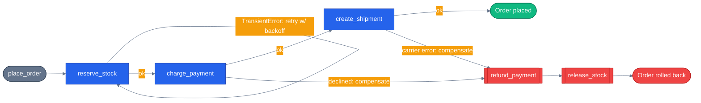

# Chapter 31 — Retry and Compensation (Saga Pattern)

A saga is what you build when a multi-step process has no single transaction to roll back. This chapter builds one in plain code, with no LLM and no agent: it decides what to retry, what to undo, and in what order.

**You will learn to:**

- Pair each step of a multi-step process with a compensating action that undoes it
- Retry a transient failure with exponential backoff, and only for steps marked retryable
- Unwind completed steps in reverse order when a step fails for good
- Tell a failure worth retrying from one that will never succeed

## Why this chapter

Placing an order touches at least three independent things: reserve inventory, charge a payment, create a shipment. Inside one Postgres database, three `UPDATE`s in one transaction either all commit or all roll back. That is what `BEGIN`/`COMMIT`/`ROLLBACK` is for.

When those three steps are three API calls to three separate services, such as a third-party payment gateway and a shipping carrier, no transaction spans them. If step three fails, steps one and two have already committed. Nothing rolls them back for you.

The **saga pattern** is the fix. Give every step an explicit **compensating action**, the opposite operation that undoes it. If a later step fails, walk backward through the steps that succeeded and run their compensations in reverse order. `reserve_stock` pairs with `release_stock`. `charge_payment` pairs with `refund_payment`. `create_shipment` pairs with `cancel_shipment`. Nobody has to open a database console and clean up a half-placed order.

**Retries are a related but separate idea, and mixing them up is the most common mistake.** A **transient** failure, such as a network timeout or a connection reset, is worth retrying with backoff, because the same call will probably succeed a moment later. A **genuine** failure, such as a declined card or an item that is out of stock, will not succeed if you call again with the same arguments. Retrying a declined payment wastes time and, if the call is not idempotent (safe to repeat), risks a double charge. This chapter's demo enforces one rule: retry only on a transient-error type, and only for steps marked retryable. Anything else compensates at once.

**When it matters:** any multi-step process across independent services or API calls, where a failure partway through leaves a state a person would otherwise clean up by hand. **When it's overkill:** a single-step operation, which has nothing to unwind, or a process where partial completion is harmless. Losing an analytics event after an order succeeded needs a retry at most, not a compensation.

## Prerequisites

- Completed [Chapter 30 — Subworkflows](../30-subworkflows/)
- Python 3.12+ via `uv`
- No API key and no environment variables needed. This chapter's saga engine is deterministic code and makes no LLM calls.

## The concept

The demo models a toy "place an order" saga. In-memory dictionaries stand in for three independent services, so there is no database and no HTTP:

| Step | Action | Compensation |
|------|--------|--------------|
| 1 | `reserve_stock(product_id, qty)` | `release_stock(product_id, qty)` |
| 2 | `charge_payment(order_id, amount)` | `refund_payment(order_id)` |
| 3 | `create_shipment(order_id)` | `cancel_shipment(order_id)` |

A small saga engine, `run_saga`, runs the steps in order. Each step is a `SagaStep`: an action, its matching compensation, and a `retryable` flag. If a step's action raises `TransientError` and the step is retryable, the engine retries with exponential backoff up to a maximum attempt count. If a step raises anything else, such as `PaymentDeclinedError`, the engine stops. It then walks backward through every completed step and calls each one's compensation, printing what happens at each stage.



Compensation always runs in the *reverse* of completion order. If `charge_payment` succeeded after `reserve_stock`, an unwind refunds the payment before it releases the stock. That is the order you would want a person doing manual cleanup to follow.

## Python

Run from the repo root. The shared `tutorials/` uv project covers every chapter, so one `uv sync` is enough:

```bash
uv sync --project tutorials
uv run --project tutorials python tutorials/31-retry-and-compensation/python/main.py
```

You should see three scenarios, back to back:

```text
=== Scenario 1: happy path — all three steps succeed ===
  [ok] reserve_stock
  [ok] charge_payment
  [ok] create_shipment
  [done] order order-1 placed successfully
...

=== Scenario 2: transient network blip on reserve_stock, retried, then succeeds ===
  [retry] reserve_stock: inventory service timed out (attempt 1) (attempt 1/3, backing off 0.01s)
  [retry] reserve_stock: inventory service timed out (attempt 2) (attempt 2/3, backing off 0.02s)
  [ok] reserve_stock
  [ok] charge_payment
  [ok] create_shipment
  [done] order order-2 placed successfully
...

=== Scenario 3: payment declined — genuine failure, unwind reserved stock ===
  [ok] reserve_stock
  [failed] charge_payment: payment declined for order order-3 (not retryable — compensating immediately)
  [compensate] undoing reserve_stock
SagaResult(order_id='order-3', succeeded=False, completed_steps=['reserve_stock'], failed_step='charge_payment', compensated_steps=['reserve_stock'])
```

Scenario 2 shows a transient error retried into a success. Scenario 3 shows a genuine failure (`PaymentDeclinedError`) skip retries and unwind the one step that had completed.

Source: [`python/main.py`](./python/main.py). The saga engine's core loop retries transient failures and compensates on anything else:

```python
def run_saga(order_id: str, steps: list[SagaStep], *, max_attempts: int = 3, base_delay: float = 0.0) -> SagaResult:
    completed: list[SagaStep] = []
    for step in steps:
        attempt = 0
        while True:
            attempt += 1
            try:
                step.action()
            except TransientError as exc:
                if step.retryable and attempt < max_attempts:
                    delay = base_delay * (2 ** (attempt - 1))
                    print(f"  [retry] {step.name}: {exc} (attempt {attempt}/{max_attempts}, backing off {delay:.2f}s)")
                    if delay:
                        time.sleep(delay)
                    continue
                print(f"  [failed] {step.name}: {exc} (retries exhausted)")
                compensated = _compensate(completed)
                return SagaResult(order_id, False, [s.name for s in completed], step.name, compensated)
            except Exception as exc:
                print(f"  [failed] {step.name}: {exc} (not retryable — compensating immediately)")
                compensated = _compensate(completed)
                return SagaResult(order_id, False, [s.name for s in completed], step.name, compensated)
            else:
                print(f"  [ok] {step.name}")
                completed.append(step)
                break
    return SagaResult(order_id, True, [s.name for s in completed])
```

`_compensate` is the unwind, and it holds the whole pattern in a few lines:

```python
def _compensate(completed: list[SagaStep]) -> list[str]:
    compensated: list[str] = []
    for step in reversed(completed):
        print(f"  [compensate] undoing {step.name}")
        step.compensation()
        compensated.append(step.name)
    return compensated
```

## .NET

Source: [`dotnet/Program.cs`](./dotnet/Program.cs).

```bash
# From the repo root.
dotnet test tutorials/31-retry-and-compensation/dotnet/tests/Saga.Tests.csproj

# Note the cd.
cd tutorials/31-retry-and-compensation/dotnet
dotnet run
```

Neither command needs an API key. There is no LLM and no MAF package here, because the saga pattern is plain code.

The transient/genuine split is an exception filter, which reads more directly than Python's nested `try`:

```csharp
catch (TransientException ex) when (step.Retryable && attempt < maxAttempts)
{
    // exponential backoff, then retry
}
catch (TransientException ex)  { return Unwind(...); }   // budget spent
catch (Exception ex)           { return Unwind(...); }   // genuine failure
```

The `when` clause does the work. A `TransientException` on a step that did not opt into retries, or after the attempts are spent, falls through to compensation instead of looping.

Without an LLM, this chapter's tests can assert **the state of the world** after a failure, not only a return value:

```csharp
backends.Stock["widget"].Should().Be(before);
backends.Reservations.GetValueOrDefault("widget").Should().Be(0);
backends.Payments.Should().NotContainKey("order-3");
```

A result object that reports `compensated` while stock stays decremented is the exact bug the pattern exists to prevent, and you cannot see it from the return value alone.

Two edge cases get their own tests because they are easy to write wrong. Failing at step one means the unwind loop runs zero times, and an implementation that assumes at least one completed step throws at that point. An out-of-stock failure must not be retried: retrying will not produce inventory, and it turns an instant correct "no" into three round trips and the same "no".

## This chapter vs a real production saga

This demo simplifies several things a production saga has to handle:

| Aspect | This chapter | Production concern |
|--------|--------------|---------------------|
| State | In-memory `dict`s inside a `Backends` object, lost on process exit | Durable state — a saga log or outbox table surviving a crash mid-saga |
| Idempotency | Not addressed — a retried `charge_payment` call is assumed side-effect-free to repeat | A retried "charge card" call against a real payment gateway needs an idempotency key, or a retry risks a double charge |
| Compensation failure | Assumed to always succeed | A compensation call can itself fail (the refund API is down) — production needs its own retry/dead-letter path for compensations, not just the primary step |
| Concurrency | One saga runs synchronously, start to finish, in one function call | Real sagas often coordinate across process restarts via a message queue or workflow engine (e.g. Temporal, MassTransit's saga state machine, or a durable MAF workflow with checkpoints — see [Chapter 18 — State and Checkpoints](../18-state-and-checkpoints/)) |

## Gotchas

- **A declined payment is attempted three times.** That is what a generic `except Exception: retry` around every step does. A declined card or an out-of-stock item will not succeed on the next attempt. This engine retries only steps that raise `TransientError` *and* are marked `retryable=True`.
- **The unwind tries to undo a step that never ran.** Compensation order is the reverse of completion order, not of declaration order. If steps A, B, C are declared and C fails after A and B completed, the unwind runs B's compensation, then A's.
- **A compensation leaves the data worse than before.** A compensating action must be the exact opposite of its step. `refund_payment` needs the `order_id` it is undoing, and in a real system the exact charge id. Refunding "whatever is in the account" corrupts state.
- **Many callers retry at the same instant.** `base_delay * 2 ** (attempt - 1)` is plain exponential backoff with no jitter, which keeps the demo's output deterministic. Production retry logic adds random jitter so callers do not back off in lockstep.
- **A refund fails and nothing notices.** This demo assumes every compensation succeeds. A production saga needs a retry policy or a dead-letter queue for compensations that fail.

## Tests

```bash
uv run --project tutorials pytest tutorials/31-retry-and-compensation/python/tests -v
dotnet test tutorials/31-retry-and-compensation/dotnet/tests/Saga.Tests.csproj
```

Run both from the repo root. Neither needs an API key.

The tests prove the three behaviours in the output above and check each backend's state afterwards. A clean run compensates nothing. A genuine failure unwinds only the completed steps, in reverse order. A transient failure is retried until it succeeds or the attempts run out. The tests also show that retryability is per step, so a `TransientError` on a step marked `retryable=False` is not retried.

## How this shows up in the capstone

The application has no saga and no compensating actions. What it does have is the retry half of this chapter, around the calls the orchestrator makes to specialist agents on a user's behalf. `agents/python/orchestrator/agent.py:248` is the blocking path of that call:

```python
try:
    async with httpx.AsyncClient(timeout=30, transport=_A2A_TRANSPORT) as client:
        resp = await client.post(
            f"{url}/message:send",
            json=request_body,
            headers=headers,
        )
        ...
        resp.raise_for_status()
        data = resp.json()
        ...
        return data.get("response", resp.text)
...
except httpx.TimeoutException:
    logger.error("a2a.timeout target=%s", log_safe(agent_name))
    return f"The {agent_name} agent took too long to respond. Please try again."
except httpx.HTTPStatusError as e:
    logger.error("a2a.error target=%s status=%s", log_safe(agent_name), e.response.status_code)
    return f"The {agent_name} agent returned an error (status {e.response.status_code}). Please try again."
except Exception:
    logger.exception("a2a.failure target=%s", log_safe(agent_name))
    return f"Failed to reach the {agent_name} agent. Please try again later."
```

`_A2A_TRANSPORT` is a `ResilientAsyncTransport` (`agents/python/shared/http_resilience.py:160`). It retries a request that fails to connect or returns a transient status (such as 503 or 429) up to three times with jittered exponential backoff, behind a circuit breaker. A `4xx` client error is not retried, which is this chapter's transient-versus-genuine rule. Once the attempts are spent, the `except` blocks log the failure and return a message for the user.

Nothing is unwound, because this is a **single** HTTP call. It is not one step of a multi-step transaction, so there is no earlier step to compensate. A saga would become necessary if checkout grew into three separate calls: reserve stock through one specialist, charge through another, ship through a third.

## What's next

- Next chapter: [Chapter 32 — Cost Control and Budgets](../32-cost-control-and-budgets/)
- Full source: [`python/`](./python/)
- Shared: [Mermaid style guide](../_shared/mermaid-style-guide.md)

<!-- BEGIN GENERATED CHAPTER NAV -->
---

**Previous:** [Chapter 30 — Subworkflows](../30-subworkflows/) · [Series index](../README.md) · **Next:** [Chapter 32 — Cost Control and Budgets](../32-cost-control-and-budgets/)
<!-- END GENERATED CHAPTER NAV -->
