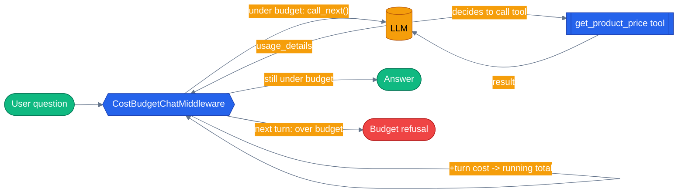

# Chapter 32 — Cost Control and Budgets

An agent loop that keeps calling tools and re-prompting the model has no stopping point of its own, because nothing in the loop knows it has become expensive. This chapter builds a small `ChatMiddleware` that tracks the dollar cost of a run turn by turn and refuses to start another turn once the total crosses a ceiling.

**You will learn to:**

- Price each model call from its token usage as the run happens
- Refuse the next model call once a run's total cost passes a ceiling
- Run a budget in `observe` mode first, so you see real numbers before anything is blocked
- Explain why enforcement is always one turn behind the overspend

## Why this chapter

[Chapter 07](../07-observability-otel/) and [`docs/concepts/13-observability-and-cost.md`](../../docs/concepts/13-observability-and-cost.md) treat cost as a *reporting* concern: turn token counts into a dollar figure, so a report can say what a request cost afterwards. That is necessary, but it is not a ceiling. A report tells you what already happened.

Nothing stops a tool-calling loop from re-prompting the model ten more times on one user request if the model keeps deciding it needs one more lookup. By the time a report shows the number, the money is spent.

This chapter's middleware closes that gap. It uses the same pricing formula a report would, called on every turn *as the run happens*, with a hard stop available if you want one.

## Prerequisites

- Completed [Chapter 06 — Middleware and the Agent Pipeline](../06-middleware/). This chapter assumes you know the three middleware kinds and how `call_next()` works.
- No API key needed: with none set, `main.py` replays recorded responses and prints one line saying so. To use a live model instead, put `OPENAI_API_KEY` (or the `AZURE_OPENAI_*` variables) in the repo-root `.env`
- Skim [`docs/concepts/13-observability-and-cost.md`](../../docs/concepts/13-observability-and-cost.md) for the background on tokens as the unit of cost. This chapter builds runtime enforcement on top of it.

## The concept

A cost *ceiling* and a cost *report* answer different questions at different times. A report answers "what did this cost?" once the run is over. That is useful for a dashboard and useless for stopping a runaway request while it is still spending. A ceiling answers "should the next turn happen at all?" It has to run *inside* the loop and check the running total before every model call.

That is why this is middleware (code that runs around a call) and not a wrapper around the final response. `ChatMiddleware.process()` fires once per raw model call. For a tool-calling agent that means several times per user question, which is the granularity a budget check needs.

The budget has three modes, set by `COST_BUDGET_MODE` in the capstone (the full application in this repo):

- `"off"`: the middleware is not attached.
- `"observe"`: add up and log every turn's cost. Never block, even past the ceiling.
- `"enforce"`: the same accounting, and refuse the next turn once the running total exceeds the ceiling.

`observe` is the safe default because it cannot change a run's outcome, only its logs. You can turn cost tracking on in production and watch real numbers for a while before you risk refusing a legitimate expensive request. In the application, `COST_BUDGET_MODE` defaults to `"observe"` and the ceiling, `COST_BUDGET_USD_PER_RUN`, defaults to unset. Nothing is refused until an operator sets both.

Enforcement has one limitation. Cost is known only *after* a turn completes, from its usage data. You cannot know a turn's price before making it. So `enforce` mode is one turn behind the overspend. It cannot abort a call in flight; it can only refuse the *next* one, once completed turns have crossed the line. A run can finish slightly over budget, by the cost of the last permitted turn, but never far over it.



The middleware sits *between* every model call and the model. It can let a turn through, price it afterwards, and refuse the next one, and the agent's own code never knows a budget exists.

## Python

Run from the repo root. The shared `tutorials/` uv project covers every chapter, so one `uv sync` is enough:

```bash
uv sync --project tutorials
uv run --project tutorials python tutorials/32-cost-control-and-budgets/python/main.py
```

You should see:

```text
No LLM key found - replaying the recorded fixture (set OPENAI_API_KEY or the AZURE_OPENAI_* variables for a live run).
budget: $0.0015 per run (mode=enforce)

Q: What's the price of product P-100?
A: The price of product P-100 is $129.99.

Q: What's the price of product P-200?
A: The price of product P-200 is $49.50.

Q: What's the price of product P-300?
A: The price of product P-300 is $899.00.

turns recorded: 0
turns blocked:  0
running total:  $0.0000 (budget $0.0015)
```

All three questions are answered and the counters stay at zero. That is expected without a key: the replay client does not run chat middleware, so the budget never fires (see Gotchas). With a key, the budget records each turn and refuses the third question. That output is shown below.

Source: [`python/main.py`](./python/main.py). The middleware itself:

```python
class CostBudgetChatMiddleware(ChatMiddleware):
    def __init__(self, *, budget_usd: float, mode: str = "enforce") -> None:
        self.budget_usd = budget_usd
        self.mode = mode
        self.total_cost_usd = 0.0
        self.turns_recorded = 0
        self.blocked = 0

    async def process(self, context: ChatContext, call_next: Callable[[], Awaitable[None]]) -> None:
        if self.mode == "off":
            await call_next()
            return

        if self.mode == "enforce" and self.total_cost_usd > self.budget_usd:
            self.blocked += 1
            context.result = ChatResponse(
                messages=[Message(role="assistant", contents=[BUDGET_REFUSAL_MESSAGE])],
                finish_reason="length",
            )
            return  # short-circuit — call_next() is never invoked

        await call_next()
        if context.result is None:
            return
        self._record(context.result)
```

`_record()` reads `context.result.usage_details`, the attribute a live client fills from the provider's response. It converts the token counts to dollars with a single-model version of the application's `estimate_cost()` and adds the result to `self.total_cost_usd`. Checking before `call_next()` and recording after it is the whole mechanism. The rest of the class is bookkeeping for the demo's printout.

`build_agent()` wires the tool and the middleware the way Chapter 06 wires its middleware classes:

```python
def build_agent(budget_middleware: CostBudgetChatMiddleware, client: object | None = None) -> Agent:
    return Agent(
        client or _default_client(),
        instructions=INSTRUCTIONS,
        name="cost-budget-agent",
        tools=[get_product_price],
        middleware=[budget_middleware],
    )
```

`main()` asks three questions against the *same* middleware instance, so cost accumulates across them as it would across a longer run. One tool-calling question is only two model turns, which is not enough to trip a ceiling. `DEMO_BUDGET_USD_PER_RUN` is a fraction of a cent so that the ceiling trips within three short questions; a real deployment sets `COST_BUDGET_USD_PER_RUN` for its own workload. With an API key, a run against Azure OpenAI looks like this:

```text
budget: $0.0015 per run (mode=enforce)

  [budget] turn 1: +$0.0004 (in=120 out=19) -> running total $0.0004
  [budget] turn 2: +$0.0004 (in=151 out=15) -> running total $0.0008
Q: What's the price of product P-100?
A: The price of product P-100 is $129.99.

  [budget] turn 3: +$0.0004 (in=120 out=19) -> running total $0.0012
  [budget] turn 4: +$0.0004 (in=151 out=15) -> running total $0.0016
Q: What's the price of product P-200?
A: The price of product P-200 is $49.50.

  [budget] refused turn 5 — running total $0.0016 already exceeds $0.0015
Q: What's the price of product P-300?
A: This run has been stopped because it exceeded its configured cost budget. Start a new request, or raise the budget if this ceiling is too low.

turns recorded: 4
turns blocked:  1
running total:  $0.0016 (budget $0.0015)
```

The first two questions each cost two turns (tool call, then answer), and both complete. After the second question the running total ($0.0016) exceeds the budget ($0.0015). So the third question's first turn is refused before it is made, and the agent's "answer" is the canned refusal text.

## .NET

Source: [`dotnet/Program.cs`](./dotnet/Program.cs).

```bash
# From the repo root. Needs no API key.
dotnet test tutorials/32-cost-control-and-budgets/dotnet/tests/CostControl.Tests.csproj

# Needs an API key in the repo-root .env. Note the cd.
cd tutorials/32-cost-control-and-budgets/dotnet
dotnet run
```

`dotnet run` calls a live model, so it needs `OPENAI_API_KEY` or the `AZURE_OPENAI_*` variables. Run the tests first if you have no key.

**The .NET tests cover what Python's keyless tests cannot.** Python's `ReplayChatClient` composes `FunctionInvocationLayer` directly and skips `ChatMiddlewareLayer`. So `CostBudgetChatMiddleware.process()` never runs under `LLM_PROVIDER=replay`, and the enforcement path is exercised end to end only against a live model. A `DelegatingChatClient` has no such gap, because it wraps whatever it is handed. The whole budget is therefore tested without a key.

```csharp
IChatClient pipeline = inner
    .AsBuilder()
    .Use(next => new CostBudgetChatClient(next, budget, log))
    .Build();
```

Order matters. The budget client sits **outside** function invocation, so each model round trip in a tool-calling loop is one budgeted turn. `A_Tool_Calling_Loop_Costs_One_Budgeted_Turn_Per_Model_Round_Trip` asserts it. If a two-turn tool call counted once, an agent looping through ten tool calls would look as cheap as one.

### Two behaviours that read like bugs

- **Enforcement is one turn behind.** Cost is known only *after* a turn completes, from its `Usage`. The turn that crosses the ceiling always runs to completion, and the one after it is refused. A budget that promised a hard cap would be promising something it cannot do. `The_Turn_That_Crosses_The_Ceiling_Still_Completes` asserts the real behaviour.
- **A refusal is a response, not an exception**, with `FinishReason.Length`. A caller cannot forget to handle it, and does not have to.

Streaming needs its own path. Usage arrives as a `UsageContent` item on the stream, not on a response object. Miss it and a streaming agent has a budget that never accumulates and never trips.

A provider that omits usage entirely gets its own counter (`TurnsUnpriced`) and is not treated as free. Silently disabling the budget is how a run goes unbounded without anything looking wrong.

## Gotchas

- **The counters stay at zero when you run without a key.** `ChatMiddleware` does not fire under `LLM_PROVIDER=replay`. The `ReplayChatClient` in `tutorials/_shared/replay_client.py` composes `FunctionInvocationLayer` directly with `BaseChatClient` and skips `ChatMiddlewareLayer`. The budget's per-turn prints and its refusal appear only against a live model. Chapter 06's PII-redaction `ChatMiddleware` has the same limitation.
- **A turn pushes the total over budget and still completes.** `enforce` checks *before* `call_next()` and records *after* it. The ceiling blocks the *next* turn, never the one running. See "The concept" above.
- **A budget of `0.0` still allows one turn.** The check is `total_cost_usd > budget_usd`, not `>=`. Before anything is spent, `0.0 > 0.0` is `False`, so the first turn always goes through. The application's `CostBudgetMiddleware` uses the same comparison.
- **Concurrent requests share one running total.** That is what you get if you copy this demo's plain instance attribute into a server. The application accumulates into `current_run_cost_usd`, a `ContextVar`, because concurrent requests run as separate asyncio tasks that must not see each other's total. This chapter's questions run one after another in one process, so an attribute is enough here.
- **A response with no usage data adds nothing to the total.** Some fixtures and some providers omit `usage_details`. `_record()` then returns without adding anything. Treat that as "no data", not "a free call", as the application's `_turn_cost()` does.

## Tests

```bash
uv run --project tutorials pytest tutorials/32-cost-control-and-budgets/python/tests -v
dotnet test tutorials/32-cost-control-and-budgets/dotnet/tests/CostControl.Tests.csproj
```

Run both from the repo root. Neither needs an API key.

The Python tests drive the middleware directly with a hand-built context. They prove that cost accumulates across turns, that `observe` never blocks, that `off` skips tracking, and that `enforce` refuses the turn after the total passes the budget. The replay test checks only the tool-calling answer, for the reason given in Gotchas. Tests against a live model, skipped unless credentials are present, run the three-question demo and assert the budget trips.

## How this shows up in the capstone

Every specialist agent and the orchestrator in the application run with a cost budget middleware. It adds up the estimated cost of each model call in a request and, in `enforce` mode, stops the request with a refusal message once it passes the configured ceiling.

That middleware is `CostBudgetMiddleware`, in `agents/python/shared/guardrails/cost_budget_middleware.py`. Its `process()` method is the check-before, record-after pattern this chapter teaches. The one structural difference is the accumulator. The application reads and writes `current_run_cost_usd`, a `ContextVar` in the same file, so concurrent requests never see each other's running total.

It joins the standard middleware stack in `build_specialist_middleware()` (`agents/python/shared/middleware.py`), gated on the mode flag:

```python
if settings.COST_BUDGET_MODE != "off":
    stack.append(CostBudgetMiddleware())
```

Both settings live in `agents/python/shared/config.py`: `COST_BUDGET_MODE` (default `"observe"`) and `COST_BUDGET_USD_PER_RUN` (default `None`).

The conversion from token counts to dollars is `estimate_cost()` in `agents/python/shared/cost.py`, which this chapter's `estimate_cost_usd()` reduces to one model's pricing. `agents/python/tests/test_cost_budget.py` is the application's test suite for the middleware, and this chapter's middleware tests follow its shape.

## What's next

- Previous chapter: [Chapter 31 — Retry and Compensation](../31-retry-and-compensation/)
- Full source: [`python/`](./python/)
- Concept deep dive: [`docs/concepts/13-observability-and-cost.md`](../../docs/concepts/13-observability-and-cost.md)
- Shared: [Mermaid style guide](../_shared/mermaid-style-guide.md) · [Jargon glossary](../_shared/jargon-glossary.md)

<!-- BEGIN GENERATED CHAPTER NAV -->
---

**Previous:** [Chapter 31 — Retry and Compensation (Saga Pattern)](../31-retry-and-compensation/) · [Series index](../README.md) · **Next:** [Chapter 33 — Prompt Injection and Red Team](../33-prompt-injection-and-red-team/)
<!-- END GENERATED CHAPTER NAV -->
