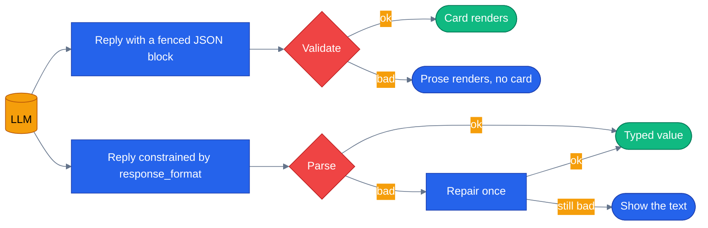

# Chapter 34 — Structured Output

A model answers in text. A UI, a database or another function wants a type. This chapter covers the two ways this application bridges that gap, and what to do when the model gets the shape wrong.

**You will learn to:**

- Validate the typed JSON a model writes inside a reply, and drop a bad card without breaking the message
- Ask a model for a typed object with `response_format` and read it back as a Pydantic model
- Choose a strict schema for what you ask the model to produce and a permissive one for what you accept
- Handle a parse failure with a bounded repair, then a fallback to plain text

## Why this chapter

Every product and order card in the chat UI starts as JSON the model typed by hand. The prompt tells each specialist to wrap product data in a fenced block, the orchestrator passes the block through, and the browser turns it into a card with an "Add to cart" button. A model writing JSON from memory gets it wrong in small ways all the time: a price as a word, a rating of 47, a brace missing at the end of a truncated reply.

So the application validates the text twice, once on the backend to check the claims against real data, and once in the browser to decide whether to draw a card at all. This chapter rebuilds both checks in Pydantic and then shows the other half of the story, the MAF `response_format` option, where the SDK asks the provider for JSON that matches a schema and parses it for you.

One fact to carry through the chapter: **the application does not use `response_format` anywhere.** Its typed data travels as fenced JSON inside prose, because the same reply has to be readable text for a human and a card for the UI. `response_format` is the better tool when nothing but code reads the reply, and that is the case the second half teaches.

The example here: **validate a product card the model wrote, then ask for a typed shopping answer and check its ids against the tool that supplied them.**

## Prerequisites

- Completed [Chapter 02 — Adding Tools](../02-add-tools/). This chapter assumes you know how a `@tool` and its `Annotated` arguments work.
- No API key needed: with none set, `main.py` replays recorded responses and prints one line saying so. To use a live model instead, put `OPENAI_API_KEY` (or the `AZURE_OPENAI_*` variables) in the repo-root `.env`. Steps 1 and 3 call no model.
- Chapter [24 — RAG and Grounding](../24-rag-and-grounding/) helps for step 2's last line, but is not required.

## The concept

There are two kinds of structured output, and they fail differently.

**Typed data inside prose.** The model writes a sentence, a fenced block with JSON, and another sentence. Nothing constrains the JSON while the model writes it, so every consumer has to assume it may be wrong. The safe rule is the one the browser uses: validate, and if validation fails, show the prose and skip the card. A half-rendered card with a wrong price is worse than no card.

**A typed reply.** You pass a Pydantic model as `response_format`. The SDK sends the model's JSON schema to the provider, the provider constrains its output to match (where it supports that), and `response.value` parses the text into your type. It is stricter and easier to consume. It also still fails: a provider without schema support, a refusal, a length cutoff or a model that ignores the constraint all produce text that does not parse, and `response.value` raises a `ValidationError`.

Neither kind checks that the content is true. A well-formed product id can be one the model made up. A schema says the id is a string; only a lookup against the tool result says it exists. Step 2 ends on that check.

Two schemas help here, with opposite rules. The schema you hand the model should be **strict**: no extra fields, every field required, so the provider can constrain tightly and you notice drift. The schema you accept from untrusted text should be **permissive**: optional fields, unknown fields kept, only the dangerous things (numbers out of range, strings too long) rejected. The chapter's `Pick` and `ProductCard` are one of each.



Both routes end somewhere a user can read. Neither ends in an exception.

## Python

Run from the repo root. The shared `tutorials/` project covers every chapter:

```bash
uv sync --project tutorials
uv run --project tutorials python tutorials/34-structured-output/python/main.py
```

You should see (step 2's answer is a recorded model reply, so your run prints the same text):

```text
No LLM key found - replaying the recorded fixture (set OPENAI_API_KEY or the AZURE_OPENAI_* variables for a live run).
Step 1. Card frames: what survives validation, and what the user would see instead.
  [well-formed card] card kept: Sony WH-1000XM5 at $299.99, rating 4.7
      backend claim extractor saw 1 product claim(s)
  [price is a word] card dropped: price: Input should be a valid number, unable to parse string as a number
      backend claim extractor saw 1 product claim(s)
  [rating out of range] card dropped: rating: Input should be less than or equal to 5
      backend claim extractor saw 1 product claim(s)
  [truncated JSON] card dropped: not JSON (Expecting property name enclosed in double quotes)
      backend claim extractor saw 0 product claim(s)

Step 2. response_format on a real model. Q: I want wireless noise-cancelling headphones under 350 dollars.
  type: ShoppingAnswer; summary: Here are two wireless noise-cancelling headphones under $350 that are highly rated. These options offer a range of features and price points to match your needs.
  pick: Sony WH-1000XM5 $299.99 (dc9e2baa...) - Top-rated wireless noise-cancelling headphones with premium sound quality under your budget.
  pick: JBL Tune 770NC $99.95 (b1e5aaad...) - Affordable option with active noise cancelling and reliable wireless performance.
  ids the tool never returned: none

Step 3. A parse failure: one repair, then fall back to text.
  bad then good: value=yes, model calls: 2
  always bad:    value=no, model calls: 2, shows text instead
```

Step 1 shows the same reply mutated three ways. Each bad card is dropped for a stated reason, and the sentence around it still renders. The line under each case is the backend's claim extractor (`extract_claims`), and it tells you something worth noticing: it still saw a product in the "price is a word" and "rating out of range" cases. It reads ids and prices for grounding and tolerates what it cannot parse. Drawing is the browser's job, so the strict gate lives there.

Source: [`python/main.py`](./python/main.py). The permissive card schema and the strict one the model gets:

```python
class ProductCard(BaseModel):
    model_config = ConfigDict(extra="allow")

    id: SafeStr | None = None
    price: Price | None = None  # 0 to 1,000,000
    rating: Annotated[float, Field(ge=0, le=5)] | None = None
    description: Annotated[str, StringConstraints(max_length=4000)] | None = None

    @model_validator(mode="before")
    @classmethod
    def drop_nulls(cls, data):
        return {k: v for k, v in data.items() if v is not None} if isinstance(data, dict) else data


class Pick(BaseModel):
    model_config = ConfigDict(extra="forbid")

    id: str = Field(description="The product id exactly as the search tool returned it.")
    name: str
    price: float
    reason: str
```

`drop_nulls` is a real lesson from the browser code. Models write `"description": null` for an empty field, and a schema that accepts `undefined` but not `null` would throw away a perfectly good card.

Asking for the typed reply is one option on the run, and reading it back is one property:

```python
response = await build_agent(client).run(question, options={"response_format": ShoppingAnswer})
value = response.value  # a ShoppingAnswer, or ValidationError if the text does not match
```

And the repair loop, which is bounded on purpose:

```python
for attempt in range(1, max_repairs + 2):
    response = await agent.run(prompt, options={"response_format": ShoppingAnswer})
    try:
        value = response.value
    except ValidationError as exc:
        prompt = f"{question}\n\nYour previous reply was rejected ({_short(exc)}). Reply again with valid JSON."
        continue
    return Outcome(value, response.text, attempt)
return Outcome(None, text, max_repairs + 1)
```

The scripted client in step 3 returns bad JSON first and good JSON second, so the repair path runs without a model and the counts are exact: two calls either way, then a value in one case and the text in the other.

Recorded fixtures include the `response_format` in their key, so a structured call never replays a prose fixture recorded without one. The key holds the schema's class name and JSON schema, which means a changed field description is a changed request. Re-record with `RECORD=true` after editing `ShoppingAnswer`.

## .NET

This chapter is Python-only. The .NET stack validates the same card blocks in its own grounding code, and MAF .NET has its own typed-reply path; neither has a chapter yet. The status table in the [course index](../README.md) says so.

## Gotchas

- **A card vanishes and the reply shows only text.** That is the design. The browser drops a card whose JSON fails `validateCard`, and the usual cause is a number the schema rejects (`rating` above 5, a negative `price`) or a truncated fence. Look at the raw reply, not the card.
- **A valid schema, an invented id.** `response_format` guarantees shape, not truth. A model can return a perfectly typed pick whose id was never in the tool result. Check ids against the tool output (step 2's last line), as the application's grounding verifier does for card ids.
- **A null field kills the whole card.** A schema that treats `null` as invalid for an optional field rejects `"description": null`. Strip nulls before validating, as `drop_nulls` does here and `dropNulls` does in the browser.
- **`response.value` raises on bad text.** It does not return `None`. Wrap the access in `try`, or you turn a model slip into a 500. Catch `ValidationError`, not a bare `Exception`.
- **A strict schema sent to a provider that cannot enforce it.** Providers differ on JSON-schema support (the [capability table](../../docs/model-providers.md) has a JSON probe per model). On a model without it you get prose, and your parse fails. Plan for the fallback even when the provider you tested passes.
- **Retrying forever.** A repair loop with no bound turns a model that cannot produce your schema into a bill. Keep `max_repairs` at one or two, and have a fallback that needs no model.
- **Strict and permissive are different jobs.** A schema that allows extra properties gives the provider little to enforce, and OpenAI's strict mode asks for `additionalProperties: false`, so do not hand the permissive card schema to `response_format`. Using the strict schema on incoming card text drops cards for a stray field.

## Tests

Run from the repo root. None needs a key. The Python command needs the dev extras: `uv sync --project tutorials --extra dev`.

```bash
uv run --project tutorials pytest tutorials/34-structured-output/python/tests -v
```

The tests cover three groups. The card schema keeps a well-formed card, treats `null` as absent, keeps unknown fields, normalises strings, and drops cards with a price word, a rating of 47, a price above the ceiling or truncated JSON, while one bad entry in a `products` fence leaves the others alone. The structured-output tests check that the model-facing schema is strict (`additionalProperties` is false) and the card schema is not, and that a valid answer can still carry an invented id. The failure tests drive the scripted client: one repair recovers, repair is bounded, zero repairs means one call, and `response.value` raises on bad JSON. One replay test plays back the recorded model answer and checks its ids are all in the catalogue.

## How this shows up in the capstone

Every card in the chat UI goes through this pipeline: the model writes a fenced block, the backend extracts claims from it, and the browser validates it before drawing.

The prompt contract is in `config/prompts/_shared/grounding-rules.yaml`, which tells every agent to emit one-line ```` ```product ````, ```` ```products ```` and ```` ```order ```` fences and never to invent an id. On the backend, `extract_claims()` in `agents/python/shared/grounding/extractor.py` pulls those fences out with a regex, skips a fence whose JSON does not parse, and hands product and order claims to the grounding verifier. In `enforce` mode, `rewrite_cards()` in the same file drops or corrects a card that fails verification. In the browser, `validateCard()` in `web/src/lib/chat-schemas.ts` runs a Zod schema per card kind (product, order, checkout, return, sentiment, inventory, pricing); a card that fails falls back to the markdown text, never to a half-drawn card. `dropNulls()` in that file is the null rule this chapter ports.

The one place the application touches `response_format` is the replay key. `_response_format_key()` in `agents/python/shared/replay_client.py` folds a Pydantic model's JSON schema into the fixture hash, so a structured call cannot replay a prose recording.

What the application leaves out is the typed reply. Nothing there asks a model for a Pydantic object, because every reply is also read by a person. If you add a code-only step (a classifier, an extractor feeding a workflow), `response_format` plus the bounded repair in this chapter is the pattern to start from.

## What's next

- Previous chapter: [Chapter 33 — Prompt Injection and Red Team](../33-prompt-injection-and-red-team/)
- Next chapter: [Chapter 35 — Memory](../35-memory/)
- Full source: [`python/`](./python/)
- Shared: [Mermaid style guide](../_shared/mermaid-style-guide.md) · [Jargon glossary](../_shared/jargon-glossary.md)

<!-- BEGIN GENERATED CHAPTER NAV -->
---

**Previous:** [Chapter 33 — Prompt Injection and Red Team](../33-prompt-injection-and-red-team/) · [Series index](../README.md) · **Next:** [Chapter 35 — Memory](../35-memory/)
<!-- END GENERATED CHAPTER NAV -->
