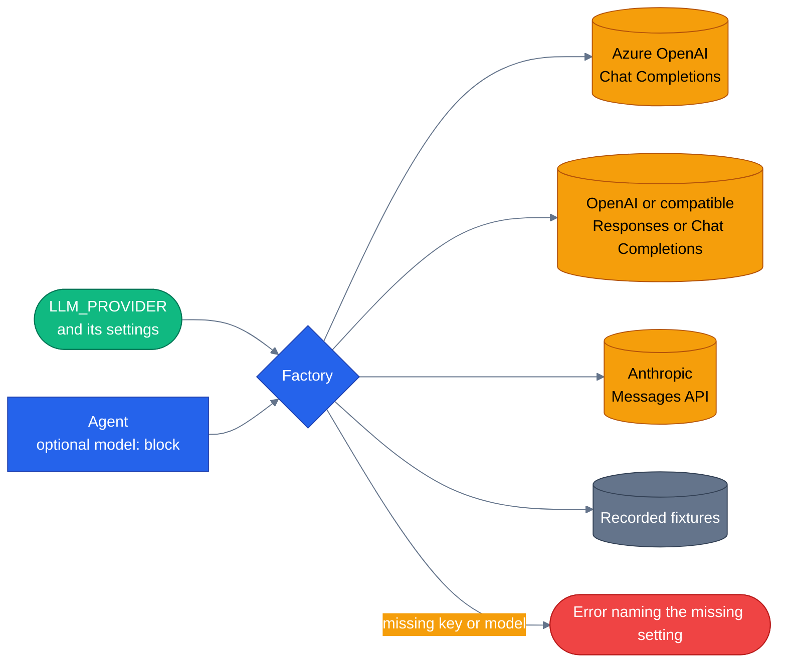

# Chapter 36 — Model Providers

Every chapter so far ran on whichever model the key pointed at. This chapter is about that choice: how one environment variable switches the provider, how a single agent can use a different model, what the repo's stored probes say each model can do, and which providers it has never actually called.

**You will learn to:**

- Switch the application between Azure OpenAI, OpenAI, an OpenAI-compatible server and replay with `LLM_PROVIDER`
- Give one agent its own model without changing the others
- Read the capability table and the not-run list instead of assuming a provider works
- Say, for each provider, what was verified live, what was stubbed and what was never run

## Why this chapter

An agent definition does not name a model. It takes a chat client, and the client is what talks to a provider. That separation is the reason the same specialists run on Azure OpenAI in one deployment, a local Ollama server in another and recorded fixtures in CI. It is also the reason "it works on my provider" proves less than it sounds: a provider differs in the wire it speaks (Responses or Chat Completions), the parameters it accepts (`temperature`, `max_tokens`), whether it calls tools reliably and whether it constrains JSON.

So this repo keeps two things beside the code that switches providers: a table of what each model did when probed, and a list of what was never run. This chapter teaches you to read both, and to be exact about verification. Three levels are in play, and they are not interchangeable. **Verified live** means this repo made real calls and stored the result. **Stubbed** means a test drives the client wiring against a fake transport, so the shape of the request is checked and the model's behaviour is not. **Never run** means exactly that.

The example here: **print what each setting would build, run one turn on a recording, and read the stored probe results model by model.**

## Prerequisites

- Completed [Chapter 01 — Your First Agent](../01-first-agent/). This chapter assumes you have built an agent from a chat client.
- No API key needed: with none set, `main.py` replays recorded responses and prints one line saying so. To use a live model instead, put `OPENAI_API_KEY` (or the `AZURE_OPENAI_*` variables) in the repo-root `.env`. Steps 1 to 3 call no model.
- Read [`docs/model-providers.md`](../../docs/model-providers.md), which this chapter walks through. The variable reference is [`docs/configuration.md`](../../docs/configuration.md).

## The concept

Four values of `LLM_PROVIDER` exist in the application, and a fifth, `replay`, takes no model at all.

- `azure` builds a Chat Completions client. The model is a **deployment name** you chose, which is not necessarily a model id.
- `openai` builds a Responses API client by default, or a Chat Completions client with `LLM_API=chat_completions`. With `LLM_BASE_URL` set, the same value reaches any OpenAI-compatible server: Ollama, vLLM, LM Studio, OpenRouter. A server with no `/responses` route needs `chat_completions`; a 404 on `/responses` is the symptom of forgetting it.
- `anthropic` builds MAF's Anthropic connector, speaks the Messages API and reads `ANTHROPIC_MODEL`, not `LLM_MODEL`.
- `replay` serves recorded responses keyed by the exact request, with no network.

An agent can override the global choice with a `model:` block in its prompt YAML: a model, a temperature or a provider. The rule that catches people is the base URL. `LLM_BASE_URL` belongs to the global `openai` endpoint, so an agent that switches to `openai` from another provider talks to `api.openai.com`, not to your local server.

The capability table answers a different question: not "what does this model know" but "which wire features did it handle." A probe is one small request per feature (tool call, parallel tool calls, answering from a tool result, a forced tool choice, streaming a tool call, JSON output, a large prompt, a `temperature` parameter, embeddings). A pass says the shape works. It says nothing about quality, and a model that passes every probe can still pick the wrong tool.



Amber boxes are external services. The factory refuses to guess: a missing key or an unknown provider is an error that names the fix, never a silent fallback.

## Python

Run from the repo root. The shared `tutorials/` project covers every chapter:

```bash
uv sync --project tutorials
uv run --project tutorials python tutorials/36-model-providers/python/main.py
```

You should see (step 4's answer is a recorded model reply, so your run prints the same text):

```text
No LLM key found - replaying the recorded fixture (set OPENAI_API_KEY or the AZURE_OPENAI_* variables for a live run).
Step 1. The tutorials' key rule: which provider does each environment select?
  nothing set                    -> replay
  OPENAI_API_KEY only            -> openai
  Azure endpoint and key         -> azure
  Azure key but no endpoint      -> replay
  key set, LLM_PROVIDER=replay   -> replay

Step 2. The application's factory: what each LLM_PROVIDER builds.
  replay
    ReplayChatClient via none (recorded); model any; endpoint provider default; constructed: (not built here)
    note: a request with no fixture fails
  azure
    OpenAIChatCompletionClient via Chat Completions; model gpt-4.1; endpoint provider default; constructed: OpenAIChatCompletionClient
    note: the model is a deployment name, not a model id
  openai
    OpenAIChatClient via Responses API; model gpt-4.1; endpoint provider default; constructed: OpenAIChatClient
  openai-compatible (Ollama)
    OpenAIChatCompletionClient via Chat Completions; model qwen2.5:7b; endpoint http://localhost:11434/v1; constructed: OpenAIChatCompletionClient
  anthropic
    AnthropicClient via Messages API; model claude-sonnet-5-5; endpoint provider default; constructed: (not built here)
    note: stub-tested only, never run against the live API
  openai, one agent on a smaller model
    OpenAIChatClient via Responses API; model gpt-4.1-mini; endpoint http://localhost:11434/v1; constructed: OpenAIChatClient
  azure global, one agent on api.openai.com
    OpenAIChatClient via Responses API; model gpt-4.1-mini; endpoint provider default; constructed: OpenAIChatClient
  error [unknown provider]: Unknown LLM_PROVIDER: 'gemini'. Must be one of openai, azure, anthropic, replay.
  error [azure with no deployment]: Azure OpenAI requires AZURE_OPENAI_DEPLOYMENT.
  error [anthropic global, agent to openai, no model]: model.model is required when an agent switches from anthropic to openai

Step 3. Capability probes stored in the repo (one small request per capability, not a quality score).
  Azure OpenAI   gpt-4.1-mini         2026-11-24  9/9 pass  all pass
  Azure OpenAI   gpt-4.1              2026-11-24  9/9 pass  all pass
  Azure OpenAI   gpt-5.2              2026-11-24  9/9 pass  all pass
  Azure OpenAI   gpt-5.4-mini         2026-11-24  9/9 pass  all pass
  Azure OpenAI   gpt-5.4              2026-11-24  9/9 pass  all pass
  Azure OpenAI   gpt-5.6-luna         2026-11-24  8/9 pass  failed: temperature_param
  Azure OpenAI   gpt-5.6-sol          2026-11-24  8/9 pass  failed: temperature_param
  Azure OpenAI   gpt-5.6-terra        2026-11-24  8/9 pass  failed: temperature_param
  Ollama (local) maternion/fara:7b    2026-11-24  4/9 pass  failed: tool_calling, parallel_tool_calls, tool_choice, streaming_tools, embeddings
  Ollama (local) qwen2.5:7b           2026-11-24  7/9 pass  failed: tool_choice, embeddings
  never probed: OpenAI direct (api.openai.com); Anthropic Messages API (api.anthropic.com); Claude deployments on the Azure account (claude-sonnet-5, claude-opus-5); LM Studio, vLLM, llama.cpp, OpenRouter, LiteLLM, Gemini; Azure embeddings other than text-embedding-3-small

Step 4. One turn on a recording. Q: In one sentence, what does a return window mean for a customer?
  A: A return window is the specific period during which a customer can return a purchased item for a refund, exchange, or store credit.
  the recording was made on: gpt-4.1-2025-04-14
```

Step 1 is the rule every chapter in this course uses (an explicit `LLM_PROVIDER` wins, then a key, then replay). The demo credentials in step 2 are placeholders and no request is made, but the OpenAI-family clients are really constructed, so the class names are what MAF builds. The last two scenarios in step 2 are the override rules: a model-only override keeps the endpoint, while a provider switch drops `LLM_BASE_URL`. Step 3 is the stored data in `agents/python/evals/provider-results/`, read as-is. The three `gpt-5.6` deployments passed everything except `temperature`: with the default 0.2 they answered HTTP 400. `qwen2.5:7b` called tools but ignored a forced tool choice, and `maternion/fara:7b` never called a tool at all. Step 4 closes on the point that matters for the whole course: **the answer came from a recording on `gpt-4.1-2025-04-14`, not from whatever your settings name.**

Source: [`python/main.py`](./python/main.py). The decisions of the application's factory, as a function you can run without its settings stack:

```python
def plan_client(env, override=None) -> ClientPlan:
    global_provider = env.get("LLM_PROVIDER", "").strip().lower()
    if global_provider == "replay":
        return ClientPlan("replay", "none (recorded)", "ReplayChatClient", "any", None, "...")
    if global_provider not in PROVIDERS:
        raise ValueError(f"Unknown LLM_PROVIDER: {env.get('LLM_PROVIDER')!r}. Must be one of ...")

    provider = (override.provider if override and override.provider else None) or global_provider
    override_model = override.model if override else None
    ...
    if provider == "openai":
        # LLM_BASE_URL belongs to the global openai endpoint. An agent that switches to openai
        # from another provider talks to api.openai.com.
        base_url = (env.get("LLM_BASE_URL") or None) if global_provider == "openai" else None
        chat_completions = env.get("LLM_API", "responses") == "chat_completions"
```

It is a port of `_build_provider_client` in `agents/python/shared/factory.py`, not an import: the factory reads the backend's whole settings object. A test reads the factory's source and fails if the decisions this port copies are no longer there. Reading the stored probes is a few lines:

```python
for path in sorted(directory.glob("*__*.json")):
    data = json.loads(path.read_text(encoding="utf-8"))
    caps = data["capabilities"]
    failed = tuple(name for name, c in caps.items() if c["status"] == "fail")
    passed = sum(1 for c in caps.values() if c["status"] == "pass")
```

To run the same agent on a real provider, set the variables and run the chapter. For a local server, `LLM_PROVIDER=openai LLM_BASE_URL=http://localhost:11434/v1 LLM_API=chat_completions OPENAI_API_KEY=not-needed LLM_MODEL=qwen2.5:7b`, with Ollama started at `OLLAMA_CONTEXT_LENGTH=64000`, because its 4K default silently truncates an agent's tool schemas and prompt. To add a row to the capability table, point `.env` at the provider and run `uv run python -m evals.provider_check --save-result` from `agents/python`.

## What was verified, per provider

Read this section as a statement of evidence, not as a support promise.

| Provider | What this repo has actually done | What it has not |
|---|---|---|
| `azure` | The application's replay fixtures and the chapters added alongside this one were recorded through it, and the capability probes ran live against eight chat deployments (2026-11-24). | Any region or subscription other than the one the probes ran on. Model availability moves; the docs note `gpt-4.1` is closed to new Azure customers. |
| `openai` and OpenAI-compatible | The wiring is covered by stubbed-transport tests. The compatible path was probed live against two local Ollama models. The Azure runs exercise the same Chat Completions wire the compatible path uses. | No run in this repo called `api.openai.com`; the probe table lists it as not run. vLLM, LM Studio, OpenRouter and LiteLLM have not been run at all. |
| `anthropic` | Stubbed `httpx2` transport (Python) and a stub handler (.NET): request shape, a canned tool round trip, usage mapping, blocking and streaming. | **Never run against the live API.** Tool-choice quality, prompt caching, real error shapes and streaming edge cases are unknown. |
| `replay` | Every CI eval and every chapter in this course. | Anything about a model other than the one recorded. |

Anthropic deserves a plain sentence of its own. It is a configured, stub-tested option. Until someone records a keyed run, do not describe it as supported, and expect its cost to read as unknown, because no Claude price is in `agents/python/config/pricing/models.yaml`.

## .NET

This chapter is Python-only. The .NET stack selects the same four providers from the same `LLM_PROVIDER` and always uses Chat Completions; `LLM_API` is Python-only. Parity row 48 in [`docs/parity-matrix.md`](../../docs/parity-matrix.md) covers the `LLM_TEMPERATURE` behaviour on both stacks. The status table in the [course index](../README.md) shows the chapter has no .NET port.

## Gotchas

- **A 404 on `/responses` against a local server.** The `openai` provider defaults to the Responses API, and most compatible servers have no such route. Set `LLM_API=chat_completions`.
- **`LLM_MODEL` is set and ignored.** You are on `anthropic`, which reads `ANTHROPIC_MODEL`. The compose files forward a `gpt-4.1` default for `LLM_MODEL` that Anthropic would reject, which is why the factory ignores it.
- **HTTP 400 about `temperature` on a newer deployment.** The application sends `LLM_TEMPERATURE` (default 0.2) on every run. Three `gpt-5.6` deployments rejected it, and the stored probe shows how: the value is accepted with reasoning effort `none` and rejected with `low`. Set `LLM_TEMPERATURE=` (empty) to omit the option. The probe also found the `gpt-5` family wants `max_completion_tokens` where `gpt-4.1` takes `max_tokens`; that was a probe finding only, and was not checked against the agent stack's own client.
- **An agent on another provider still talks to the wrong host.** A per-agent `provider:` switch needs that provider's own credentials, and `LLM_BASE_URL` is not inherited by an agent that switches to `openai`. Step 2's last scenario shows it.
- **Answers with no real data after switching to a small local model.** It stopped calling tools instead of erroring. A model with weak function calling answers from memory. Check the probe row for `tool_calling` before blaming the prompt.
- **A passing probe taken for a quality guarantee.** Nine passes mean nine request shapes worked once. The eval scorecard in [`docs/eval-scorecard.md`](../../docs/eval-scorecard.md) is a replay of one recorded model, so it is a regression signal for that recording and says nothing about the model you switch to. Measuring another model needs a fresh keyed recording, which only a human dispatches.
- **Semantic search goes empty after a switch.** Embeddings are configured separately (`EMBEDDING_*`). Anthropic has no embeddings API at all, and a compatible chat URL is rarely an embeddings endpoint.
- **A recording replays under any provider setting.** The replay key ignores the model name. That is what makes the course keyless and also why a green replay run cannot tell you a new provider works.

## Tests

Run from the repo root. None needs a key. The Python command needs the dev extras: `uv sync --project tutorials --extra dev`.

```bash
uv run --project tutorials pytest tutorials/36-model-providers/python/tests -v
```

The tests pin each decision. The key rule picks `replay`, `openai`, `azure` and `replay` for the four environments and refuses an unknown explicit provider. The plan picks the Responses API for `openai` and Chat Completions for `azure` and for a compatible endpoint, ignores `LLM_MODEL` on `anthropic`, keeps the endpoint across a model-only override and drops it across a provider switch. Each misconfiguration fails with a message that names the fix. Every planned OpenAI-family client is constructed offline. The stored probe rows are read back and asserted (the `gpt-5.6` deployments fail only `temperature_param`, `qwen2.5:7b` fails `tool_choice`), the never-probed list must contain Anthropic and `api.openai.com`, and a drift guard checks the factory source still contains the decisions this chapter ports. One replay test checks the answer and the model the recording names.

## How this shows up in the capstone

Every specialist and the orchestrator get their chat client from one function, so switching provider is a `.env` change and a restart, never a code edit.

- `_build_provider_client()` in `agents/python/shared/factory.py` is the function `plan_client` ports: it validates the provider, applies a per-agent override, picks the client class and decides whether `LLM_BASE_URL` applies. `get_chat_client()` in the same file is what the agents call.
- `ModelOverride` in `agents/python/shared/prompt_loader.py` parses the optional `model:` block and keeps it out of the prompt text. No shipped YAML sets one.
- `_CHAT_PROBES` in `agents/python/evals/provider_check.py` runs the capability probes, whose results land in `agents/python/evals/provider-results/`.
- `load_results()` in `scripts/build_provider_table.py` renders them into `docs/model-providers.md`, and CI fails when that table is stale.
- `served_model()` in `agents/python/shared/run_usage.py` reads which model a provider says it served, which is how cost is priced from what ran and not from what was configured.

What the capstone adds is what a tutorial cannot: gateway attribution headers on every model call, per-model pricing with an unknown price reported as unknown, Azure managed identity, and a Foundry account for Azure deployments. The page to read next is [`docs/model-providers.md`](../../docs/model-providers.md).

## What's next

- Previous chapter: [Chapter 35 — Memory](../35-memory/)
- After this: the [Capstone Tour](../21-capstone-tour/) shows all of it running together
- Full source: [`python/`](./python/)
- Concept deep dive: [`docs/model-providers.md`](../../docs/model-providers.md) · [`docs/configuration.md`](../../docs/configuration.md)
- Shared: [Mermaid style guide](../_shared/mermaid-style-guide.md) · [Jargon glossary](../_shared/jargon-glossary.md)

<!-- BEGIN GENERATED CHAPTER NAV -->
---

**Previous:** [Chapter 35 — Memory](../35-memory/) · [Series index](../README.md)
<!-- END GENERATED CHAPTER NAV -->
