# Chapter NN — <Chapter Title>

<!-- One or two plain sentences: what the reader builds here. No jargon the chapter has not introduced yet. -->
<What this chapter adds to the previous one, in one or two sentences.>

**You will learn to:**

<!-- Three bullets, each starting with a verb, each something the reader can do afterwards. -->
- <Do the first thing>
- <Do the second thing>
- <Do the third thing>

## Why this chapter

<!-- The concrete problem this solves. Say where the full application in this repo (the capstone) uses it. -->
<One or two paragraphs.>

The example here: **<one sentence describing the example the code runs>.**

## Prerequisites

- Completed [Chapter NN-1 — <Previous Title>](../NN-previous/)
<!-- The key statement: keep exactly one of the two bullets below. -->
- No API key needed: with none set, `main.py` replays recorded responses and prints one line saying so. To use a live model instead, put `OPENAI_API_KEY` (or the `AZURE_OPENAI_*` variables) in the repo-root `.env`.
- **Key:** `main.py`'s default prompt has no recorded fixture, so running it needs a key (live run). Without one, the chapter's tests replay their own recorded prompt: `uv run --project tutorials pytest tutorials/<chapter>/python/tests -m "not integration"`.

## The concept

```mermaid
%%{init: {'theme':'base', 'themeVariables': {
  'primaryColor': '#2563eb','primaryTextColor': '#ffffff','primaryBorderColor': '#1e40af',
  'lineColor': '#64748b','secondaryColor': '#f59e0b','tertiaryColor': '#10b981',
  'background': 'transparent'}}}%%
flowchart LR
  classDef core     fill:#2563eb,stroke:#1e40af,color:#ffffff
  classDef external fill:#f59e0b,stroke:#b45309,color:#000000
  classDef success  fill:#10b981,stroke:#047857,color:#ffffff

  input([<Input>])
  step[<Step>]
  llm[(LLM)]
  output([<Output>])

  input --> step
  step --> llm
  llm --> step
  step --> output

  class step core
  class llm external
  class output success
```

<!-- Plain language first, API names second. Spell out an acronym the first time it appears. -->
<Two or three paragraphs.>

<!-- One diagram. Keep the init block and classDefs as they are: ../_shared/mermaid-style-guide.md. -->


<One sentence saying what to notice in the diagram.>

## Python

Run from the repo root. One `uv sync` of the shared `tutorials/` project covers every chapter:

```bash
uv sync --project tutorials
uv run --project tutorials python tutorials/<chapter>/python/main.py
```

You should see:

<!-- Paste real output from a keyless run. If main.py needs a key, say so above the block. -->
```text
No LLM key found - replaying the recorded fixture (set OPENAI_API_KEY or the AZURE_OPENAI_* variables for a live run).
<expected output>
```

<One sentence on what in that output shows the concept worked.>

Source: [`python/main.py`](./python/main.py). <Name the part shown below.>

<!-- The instructive 10 to 20 lines, copied from main.py, not the whole file. -->
```python
<key lines of main.py>
```

<Walk through what those lines do.>

## .NET

`dotnet run` calls a live model, so it needs a key in the repo-root `.env`. Without a key, run the tests from the repo root; they use a scripted chat client and make no network call:

```bash
dotnet test tutorials/<chapter>/dotnet/tests/<Project>.Tests.csproj
```

With a key:

```bash
cd tutorials/<chapter>/dotnet
dotnet run
```

Source: [`dotnet/Program.cs`](./dotnet/Program.cs). <Name the part shown below.>

<!-- The same step as the Python walkthrough, so the two can be compared. -->
```csharp
<key lines of Program.cs>
```

<Walk through it, and say where it differs from Python.>

## Side-by-side differences

<!-- Only rows where the two languages differ in a way a reader would trip on. -->
| Aspect | Python | .NET |
|--------|--------|------|
| <Aspect> | `<Python API>` | `<.NET API>` |
| <Aspect> | `<Python API>` | `<.NET API>` |

<One sentence summing up the difference.>

## Gotchas

<!-- Lead each bullet with the symptom the reader sees, in bold, then the cause and the fix. -->
- **<Symptom the reader sees.>** <Cause, and how to fix it.>
- **<Symptom the reader sees.>** <Cause, and how to fix it.>
- **Some tests show as skipped.** <Which tests need a key, and that the replay tests need none.>

## Tests

Both commands run from the repo root and need no key. The Python command needs pytest from the dev extras; install them once with `uv sync --project tutorials --extra dev`:

```bash
# Python
uv run --project tutorials pytest tutorials/<chapter>/python/tests -v

# .NET
dotnet test tutorials/<chapter>/dotnet/tests/<Project>.Tests.csproj
```

<!-- Say what the tests prove about the concept, not just that they pass. -->
<What the unit tests cover, what the replay or scripted-client tests cover, and what is integration-only.>

## How this shows up in the capstone

<!-- One sentence a user of the application would recognise, then the pointer. -->
<What the full application does with this pattern.>

<!-- Point by path plus symbol, never by line number: a repo-rooted path and a backticked
     function, class or constant that is in that file. scripts/check_tutorial_readmes.py
     fails the chapter if the file is missing or the symbol is not in it. -->
`<symbol_name>()` in `agents/python/<package>/<file>.py` <does what, and how it compares with this chapter's example>.

<!-- Optional: a short excerpt of that symbol. -->
```python
<excerpt>
```

<What the application adds that this chapter's example leaves out.>

## What's next

- Next chapter: [Chapter NN+1 — <Next Title>](../NN-next/)
- Full source: [`python/`](./python/) · [`dotnet/`](./dotnet/)
- Shared: [Mermaid style guide](../_shared/mermaid-style-guide.md) · [Jargon glossary](../_shared/jargon-glossary.md)

<!-- The Previous/Next footer is generated. After adding the chapter, run:
     python3 scripts/check_tutorial_nav.py --write -->
